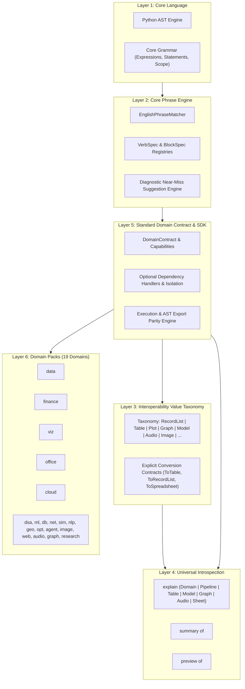

# DoomScript Architecture Specification: Spoken-English Phrase Engine, Interoperability Taxonomy, and Universal Explainability

**Date:** 2026-10-19  
**Status:** Validated Design Spec  
**Target:** DoomScript 2.0 Domain Subsystem & Core Phrase Engine  

---

## 1. Executive Summary & Architectural Philosophy

DoomScript's founding promise is **coding in English**: readable, conversational, and significantly shorter than Python, while compiling cleanly down to standard, production-safe Python AST with 100% semantic parity.

As the language scales across 19 specialized domain packs, maintaining this promise requires clear separation of concerns:
1. **Core Language owns language semantics**, not domain vocabulary. The core handles variables, expressions, functions, loops, and control flow.
2. **Core Phrase Engine owns pattern matching**, argument binding, and diagnostic suggestions. It provides a typed declarative pattern engine so domains define natural English phrases without writing fragile regexes or polluting the core grammar.
3. **Domain Packs own their operations and semantics**. Data operations (e.g. CSV loading, `where` filtering, sorting) live in the `data` domain, financial calculations in `finance`, and plotting in `viz`.
4. **Interoperable Value Taxonomy connects them**. Objects are not shoehorned into a single type. Instead, explicit runtime value types (`Scalar`, `RecordList`, `Table`, `Plot`, `Graph`, `Model`, `Audio`, `Image`, `Agent`, `Connection`, `Document`, `Spreadsheet`, `Bucket`) define clear cross-domain conversion semantics.
5. **Universal Introspection provides explainability**. Every domain and domain artifact supports structured inspection through `explain`, `summary of`, and `preview of`. Diagnostic suggestions remain **advisory-only**—DoomScript suggests fixes for near-miss syntax, but never silently guesses or reinterprets user code.

---

## 2. Layered System Architecture



---

## 3. Layer 2: Core Phrase Engine Specification

### 3.1 Pattern Template Syntax (`VerbSpec`)
Domains declare operations as typed `VerbSpec` instances using conversational English pattern templates:

* **Optional Words**: `[...]` indicates words that can be included or omitted without altering semantics (e.g. `[file]`, `[for]`, `[over]`, `[prices]`).
* **Synonym Alternatives**: `(...)` separated by `|` defines interchangeable English synonyms (e.g. `(moving average|sma|ema)`, `(horizontally|vertically)`).
* **Typed Argument Slots**:
  - `{name:ident}`: Destination variable or identifier (e.g. `into {target:ident}`).
  - `{name:expr}`: Arbitrary DoomScript expression (e.g. `point at {lat:expr}, {lon:expr}`).
  - `{name:int}`: Integer literal (e.g. `{window:int} day`).
  - `{name:float}`: Float literal (e.g. `with rate {rate:float}`).
  - `{name:str}`: Quoted string literal (e.g. `role {role:str}`).
* **Default Values**: `{name:expr|default_value}` specifies optional arguments with defaults.

### 3.2 Block Template Syntax (`BlockSpec`)
Multi-line declarative constructs (e.g. `pipeline`, `model`, `simulate`, `query`) declare their header pattern, expected section verbs, and lowering logic:

```python
@dataclass
class BlockSpec:
    name: str
    header_pattern: str
    allowed_verbs: List[str]
    lower_fn: Callable[[BlockAST], DomainIR]
    doc: str
```

### 3.3 Diagnostic Suggestion Protocol (Advisory-Only)
When an input line matches leading tokens of a registered verb but fails full parameter binding (e.g. missing `into <target>` or misspelling a preposition):
1. The engine computes Levenshtein distance and token overlap against registered `VerbSpec` patterns.
2. It raises a `DoomSyntaxError` with a structured `Did you mean?` suggestion and exact file/line location.
3. **Safety Guarantee**: The engine **never** silently reinterprets or executes an ambiguous or malformed line.

---

## 4. Layer 3: Interoperability Value Taxonomy

### 4.1 Value Types
Rather than forcing all outputs into a single representation, DoomScript defines a strict taxonomy of runtime entities:

| Category | Type Name | Representation | Primary Producing Domains |
| :--- | :--- | :--- | :--- |
| **Row-Oriented** | `RecordList` | `List[Record]` with dict/attribute access | `data`, `finance`, `db`, `net` |
| **Tabular** | `Table` | Schema, column vectors, dtypes, metadata | `data`, `finance` |
| **Visual** | `Plot` | `PlotSpec` scene tree, layers, geometries | `viz` |
| **Relational / Topology** | `Graph` | `DoomGraph`, adjacency, node/edge attributes | `graph`, `dsa` |
| **Predictive** | `Model` | `ModelContainer`, weights, features, metrics | `ml` |
| **Acoustic** | `Audio` | `DoomAudio`, PCM samples, sample rate, channels | `audio` |
| **Raster** | `Image` | `DoomImage`, Pillow canvas / pixel matrix | `image` |
| **Autonomous** | `Agent` | `Agent`, system prompt, memory buffer, tools | `agent` |
| **Documentary** | `Document` / `Spreadsheet` | `DoomWordDocument`, `DoomSpreadsheet` (OpenXML) | `office` |
| **Cloud Storage** | `Bucket` | `CloudBucket`, provider, path mapping | `cloud` |
| **Connectivity** | `Connection` | Database handle, HTTP session, socket | `db`, `net` |

### 4.2 Explicit Conversion Matrix
Conversions are explicit, deterministic, and idempotent:
* `Table` $\leftrightarrow$ `RecordList`: Lossless bidirectional conversion via `table.to_records()` and `Table.from_records(records)`.
* `RecordList` $\rightarrow$ `Spreadsheet`: `add rows from <records> to <sheet>` maps field names to header rows.
* `Table` / `RecordList` $\rightarrow$ `Plot`: Direct binding via `plot <data> as line chart with x: col1, y: col2`.
* Any artifact (`Document`, `Spreadsheet`, `Audio`, `Image`) $\rightarrow$ `Bucket`: Seamless upload via `upload file <path_or_artifact> to bucket <b_var> as <remote_key>`.

---

## 5. Layer 4: Universal Introspection (`explain`, `summary of`, `preview of`)

### 5.1 Protocol Definitions
Every domain and domain object registers hooks for the introspection trio:

```python
class Introspectable(ABC):
    @abstractmethod
    def explain(self) -> Dict[str, Any]:
        """Returns structured metadata explaining composition, parameters, or schema."""
        pass

    @abstractmethod
    def summary(self) -> str:
        """Returns a human-readable one-paragraph or tabular summary."""
        pass

    @abstractmethod
    def preview(self, n: int = 5) -> Any:
        """Returns an abbreviated representative preview of the object."""
        pass
```

### 5.2 Introspection Outputs by Target
1. **`explain domain <name>`**:
   - Registered verbs and block constructs with documentation.
   - Required optional dependencies and their live installation status.
   - Maturity level (Prototype, Usable, Stable, Professional).
2. **`explain <table>` / `explain <recordlist>`**:
   - Number of rows and columns.
   - Column names, detected types, missing value percentages, and memory footprint.
3. **`explain <pipeline>`**:
   - Ordered execution stages (inputs, transforms, filters, joins, aggregations).
   - Inferred intermediate and terminal schema.
4. **`explain <plot>`**:
   - Chart geometry, aesthetic mappings (x, y, color, size), coordinate system, and active theme.
5. **`explain <graph>`**:
   - Node count, edge count, density, directedness, connected components count.
6. **`explain <model>`**:
   - Target variable, input features, algorithm name, train/test split, and validation metrics ($R^2$, MSE, Accuracy).
7. **`explain <audio>`**:
   - Duration, sample rate, channels, bit depth, and peak decibels.

---

## 6. Layer 5 & 6: Domain Contract & Domain Pack Upgrades

### 6.1 Standard DomainContract Architecture
Every domain pack inherits from the upgraded `DomainContract`:

```python
class DomainContract(ABC):
    name: str
    aliases: List[str]
    capabilities: List[str]
    optional_dependencies: Dict[str, str]  # pkg_name -> reason
    verbs: List[VerbSpec]
    blocks: List[BlockSpec]
    runtime: DomainRuntime
    exporter: DomainASTExporter

    def can_handle_line(self, line: str) -> bool:
        return any(v.matches(line) for v in self.verbs)

    def can_handle_block(self, header: str) -> bool:
        return any(b.matches(header) for b in self.blocks)

    def explain(self) -> DomainExplanation:
        ...
```

### 6.2 Data Domain Conversational Upgrades
The `data` domain implements the primary spoken-English data verbs:
* `read csv file {path:expr} into {target:ident}`
* `read json file {path:expr} into {target:ident}`
* `{source:ident} where {condition:expr} into {target:ident}`
* `sort {source:ident} by {field:ident} [ascending|descending]`
* `write csv {source:ident} into [file] {path:expr}`
* `write json {source:ident} into [file] {path:expr}`
* `group {source:ident} by {field:ident} calculating {agg:ident} of {col:ident} into {target:ident}`

---

## 7. Verification & Conformance Plan

1. **Unit Verification**:
   - Test each `VerbSpec` and `BlockSpec` pattern parsing, variable binding, and error edge cases.
   - Verify diagnostic error suggestions on malformed user inputs.
2. **Taxonomy & Conversion Tests**:
   - Verify explicit conversion behavior across all types: `Table` $\leftrightarrow$ `RecordList` $\rightarrow$ `Spreadsheet` / `Plot`.
3. **Universal Introspection Tests**:
   - Verify `explain domain <name>` across all 19 domains.
   - Verify `explain`, `summary of`, `preview of` across Tables, Pipelines, Plots, Graphs, Models, Audio, and Sheets.
4. **Execution & Export Parity (Conformance Runner)**:
   - Ensure every new verb lowers to clean Python AST and passes conformance testing through `assert_execution_and_export_parity`.
5. **Zero Regression Guarantee**:
   - All 496 pytest test cases must pass.
   - All 40/40 Coursework Capability Benchmarks must pass.
