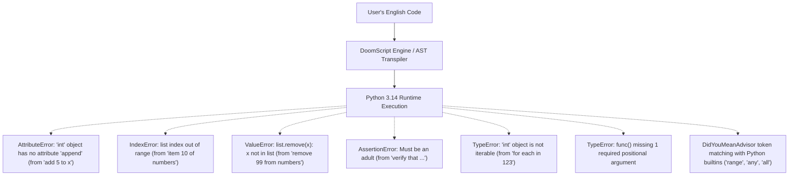

# DoomScript Comprehensive Beginner UX & Usability Audit Report

**Auditor:** Beginner UX Auditor for DoomScript  
**Audit Target:** DoomScript Language Engine & Grammar (`doomscript` 1.x / 2026 Core)  
**Date:** October 2026  
**Scope:** Exhaustive empirical evaluation of 85 natural English phrasings across 5 core programming domains from the perspective of a complete novice who has never programmed before.

---

## Executive Summary & Empirical Scorecard

DoomScript promises that analysts and operations teams can *"code in plain English intuitively without wrestling with Python boilerplate, cryptic syntax, or confusing compiler errors."*

To test this promise, an automated test harness (`scratch/audit_beginner_phrasings.py`) ran **85 intuitive English programs** covering everyday programming tasks. Each test was analyzed through all stages: **Phrase Normalization**, **Lark EBNF Parsing & AST Generation**, and **Bytecode Runtime Execution**.

### Empirical Results

| Metric | Total | Percentage |
| :--- | :---: | :---: |
| **Total Test Phrasings** | **85** | **100%** |
| ✅ **Succeeded (Intuitive & Working)** | **56** | **65.9%** |
| ❌ **Syntax Errors (Rejected at Parse Time)** | **19** | **22.4%** |
| 💥 **Runtime Errors (Compiled but Crashed)** | **6** | **7.1%** |
| ⚠️ **Normalization / Pronoun Scope Errors** | **4** | **4.7%** |
| 🐍 **Python Concept / Error Leakage Incidents** | **12** | **14.1%** |

```
[██████████████████████████████████░░░░░░░░░░░░░░░░░] 65.9% Pass Rate
```

### Key Takeaway
While DoomScript succeeds admirably at sentence-style flow for linear pipelines, data filtering, and high-level verb phrases, **it frequently punishes beginners who extrapolate English rules naturally**. 

When a beginner writes natural English variations:
1. Operations that sound identical in English (e.g. `add 5 to x` vs `add 10 to numbers`) trigger dangerous semantic collisions (attempting to invoke Python `.append()` on an integer).
2. Several intuitive expressions are trapped in rigid statement forms requiring mandatory `into <var>` clauses.
3. Common everyday English nouns (`file`, `last`, `number`) are reserved keywords that break variable assignments and loops with baffling syntax errors.
4. Python's underlying object model (`AttributeError`, `IndexError`, `ValueError`, `__init__`, `self`) repeatedly punctures the English abstraction layer.

---

## 1. What Works Well in DoomScript Today

The audit revealed several remarkable strengths where DoomScript delivers a genuinely delightful, human-readable programming experience:

1. **Expressive In-Place Arithmetic & Verbal Mutations**:
   - `increase x by 1`, `decrease x by 2` compile cleanly and accurately.
   - Colloquial math verbs such as `double x`, `halve x`, `multiply x by 3`, and `divide x by 2` work seamlessly via `phrases.py`.
2. **Natural Relational & Parity Predicates**:
   - `if x is even:`, `if x is odd:`, `if x is between 10 and 20:`, and `if x is divisible by 5:` all evaluate accurately.
   - String predicates like `if name starts with "Dr.":`, `if sentence contains "error":`, and `if name does not start with "Dr.":` read like standard English sentences.
3. **Natural 1-Based Collection Queries**:
   - Expressions like `first item of numbers`, `last item of numbers`, and `item 2 of numbers` properly abstract away 0-based programming indices.
   - Aggregations such as `count of numbers`, `length of numbers`, and `numbers's length` evaluate accurately.
4. **Ergonomic Block Keywords & Defensiveness**:
   - Block statements like `try: ... if that fails: ...` and `if that fails as problem:` provide an intuitive alternative to `try...except`.
   - `verify that <condition> otherwise "<message>"` provides clean runtime contracts without requiring Python `assert` familiarity.
5. **Class Boilerplate Minimization**:
   - DoomScript successfully allows defining constructors using `constructor with name:` or `to init with name:` and instance field assignment via `my name = name` (which desugars to `self.name = name`).
6. **Flexible Input Helpers**:
   - Typed input verbs like `ask number "What is your age?" into age` and `ask boolean "Continue?" into confirmed` streamline interactive command-line programs.

---

## 2. The Top 10 Beginner Syntax Traps

The audit exposed 10 critical UX friction points where a non-programmer writing natural English is abruptly blocked by syntax errors, bizarre compiler suggestions, or runtime crashes:

### Trap 1: The "Add" Arithmetic vs. Collection Collision
* **The Beginner's Phrasing:**
  ```doomscript
  x = 10
  add 5 to x
  ```
* **Intuitive Expectation:** Arithmetic addition ($x$ becomes 15).
* **What DoomScript Does:** In `doom.lark`, `add_stmt: "add" expr "to" target -> add_to_list` translates strictly to `x.append(5)`.
* **The Error:**
  ```
  AttributeError: 'int' object has no attribute 'append'
  Problem: A 'int' doesn't have a 'append' property.
  ```
* **UX Impact:** A beginner who writes `add 5 to x` has no concept of an `'int' object` or an `append` method. The language accepted the sentence without a syntax error, then crashed at runtime with Python OOP jargon.

---

### Trap 2: The Desugared Bracket Leakage
* **The Beginner's Phrasing:**
  ```doomscript
  numbers is a list of 1, 2, 3
  ```
* **Intuitive Expectation:** Initializes a list named `numbers` containing `[1, 2, 3]`.
* **What DoomScript Does:** The normalizer transforms `a list of 1, 2, 3` into `[1, 2, 3]`. However, `legacy_is_assign` specifically excludes `is a list` (reserving it for type checks). As a result, the source code fed to Lark is:
  ```doomscript
  numbers is [1, 2, 3]
  ```
* **The Error:**
  ```
  DoomScript Syntax Error at line 1:12
     1 | numbers is a list of 1, 2, 3
                    ^
  Problem: I didn't understand '[' here. It wasn't expected in this position.
  Did you mean: number is a list of 1, 2, 3
  ```
* **UX Impact:** The beginner never typed `[`! DoomScript injected `[` behind the scenes, failed to parse its own rewrite, and blamed the beginner for a character they never typed. Furthermore, the advisor suggested changing `numbers` to `number`.

---

### Trap 3: The Rigid "Into" Statement Requirement for Strings
* **The Beginner's Phrasing:**
  ```doomscript
  words = ["a", "b", "c"]
  set text to join words with ", "
  # Or: text = join words with ", "
  ```
* **Intuitive Expectation:** Joins the words into a single comma-separated string stored in `text`.
* **What DoomScript Does:** `join` is strictly defined as a statement: `join expr with expr into target`. It does **not** exist as an expression grammar rule (`data_op_expr`).
* **The Error:**
  ```
  DoomScript Syntax Error at line 2:18
     2 | set text to join words with ", "
                          ^
  Problem: I didn't understand 'words' here. It wasn't expected in this position.
  ```
* **UX Impact:** Beginners expect functions and string transforms to work as expressions on the right-hand side of assignments (`set text to ...` or `text = ...`). Restricting `join` exclusively to `join X with Y into Z` creates an arbitrary syntactic dichotomy.

---

### Trap 4: The In-Place String Mutation Rejection
* **The Beginner's Phrasing:**
  ```doomscript
  sentence = "the cat is happy"
  replace "cat" with "dog" in sentence
  ```
* **Intuitive Expectation:** The sentence variable is updated in-place to `"the dog is happy"`.
* **What DoomScript Does:** In `doom.lark`, `string_replace_stmt` mandates `into target`: `replace expr with expr in expr into target`. Without `into target`, parsing fails.
* **The Error & Bizarre Suggestion:**
  ```
  DoomScript Syntax Error at line 2:37
     2 | replace "cat" with "dog" in sentence
                                             ^
  Problem: I didn't recognize the command 'replace'. Did you mean 'repeat'?
  Did you mean: repeat "cat" with "dog" in sentence
  ```
* **UX Impact:** The compiler hallucinates and advises the user to execute `repeat "cat" with "dog" in sentence`—complete nonsense that would confuse any beginner.

---

### Trap 5: Reserved English Keyword Collisions (`file`, `last`)
* **The Beginner's Phrasing:**
  ```doomscript
  file = "data.csv"
  # Or: last = 10
  ```
* **Intuitive Expectation:** Assigns the string `"data.csv"` to a variable named `file`.
* **What DoomScript Does:** `file` and `last` are hardcoded token terminals in Lark. They cannot be used as variable identifiers.
* **The Error:**
  ```
  DoomScript Syntax Error at line 1:6
     1 | file = "data.csv"
              ^
  Problem: Unexpected '=' here. In DoomScript, you can write 'set x to ...' or 'x is ...'.
  ```
* **UX Impact:** In a language designed for data and file automation, `file` is the single most natural variable name a beginner will choose. Forbidding it forces arbitrary naming workarounds (`f`, `my_file`, `doc`).

---

### Trap 6: Loop Variable Keyword Shadowing
* **The Beginner's Phrasing:**
  ```doomscript
  numbers = [1, 2, 3, 4, 5, 6]
  for each number in numbers:
      if number is even:
          say number
  ```
* **Intuitive Expectation:** Iterates through `numbers` and prints even numbers.
* **What DoomScript Does:** `number` is a recognized keyword in `call_arg_name` (`arg_kw_number`). When the normalizer converts `if number is even:` into `if math_mod(number, 2) is 0:`, Lark's parser interprets the first argument `number` as a keyword argument name expecting an `=` sign. It hits the `,` separating the arguments and blows up.
* **The Error:**
  ```
  DoomScript Syntax Error at line 3:23
     3 |     if number is even:
                               ^
  Problem: I didn't understand ',' here. It wasn't expected in this position.
  ```
* **UX Impact:** If the loop variable is named `n` or `x`, the code runs flawlessly. If the loop variable is named `number` (the most natural English singular of `numbers`), it crashes. A non-programmer cannot comprehend why changing `n` to `number` breaks the grammar.

---

### Trap 7: The Apostrophe Possessive Mutation Trap
* **The Beginner's Phrasing:**
  ```doomscript
  p1 = {"name": "Alice", "age": 30}
  change p1's name to "Bob"
  # Or: modify p1's name to "Bob"
  # Or: update p1's name to "Bob"
  ```
* **Intuitive Expectation:** Updates `p1`'s `name` property to `"Bob"`.
* **What DoomScript Does:** Only `set p1's name to "Bob"` or `p1's name = "Bob"` is supported. `change`, `modify`, and `update` are not in the grammar. Worse, the error advisor treats the apostrophe in `p1's` as an unterminated single-quote string!
* **The Error:**
  ```
  DoomScript Syntax Error at line 2:8
     2 | change p1's name to "Bob"
                ^
  Problem: It looks like an unclosed single quote ('). Every opening quote needs a matching closing quote.
  Did you mean: change p1's name to "Bob"'
  ```
* **UX Impact:** The advisor instructs the user to append another single quote at the end of the line: `change p1's name to "Bob"'`!

---

### Trap 8: The Natural Schema & Entity Void
* **The Beginner's Phrasing:**
  ```doomscript
  a Person has name, age
  create a Person with name "Alice", age 30 into p1
  ```
* **Intuitive Expectation:** Defines a simple record type `Person` and creates an instance `p1`.
* **What DoomScript Does:** DoomScript only recognizes formal database ORM declarations: `define entity Person with name as text, age as number` and `save new Person with name: "Alice", age: 30 into p1`. Intuitive object/entity descriptions fail outright.
* **The Error:**
  ```
  DoomScript Syntax Error at line 1:3
     1 | a Person has name, age
           ^
  Problem: I didn't understand 'Person' here.
  Did you mean: a Person has name, range
  ```
* **UX Impact:** Non-programmers thinking in English nouns and attributes are forced to adopt SQL-table terminology (`define entity ... with ... as text`).

---

### Trap 9: Trailing Type Casts in User Prompts
* **The Beginner's Phrasing:**
  ```doomscript
  ask "What is your age?" into age as number
  ```
* **Intuitive Expectation:** Prompts for age and stores the result coerced to a number.
* **What DoomScript Does:** DoomScript only supports prefix typing (`ask number "..." into age`). The trailing `as number` clause is rejected as an invalid target.
* **The Error:**
  ```
  DoomScript Syntax Error at line 1:34
     1 | ask "What is your age?" into age as number
                                          ^
  Problem: I didn't understand 'as' here.
  Did you mean: ask "What is your age?" into range ask number
  ```
* **UX Impact:** In English, adjectives frequently follow the noun phrase (*"save this into age as a number"*). Forcing prefix notation and offering a nonsensical suggestion (`into range ask number`) creates needless confusion.

---

### Trap 10: Parenthesis Colon Leakage in Inverted Ranges
* **The Beginner's Phrasing:**
  ```doomscript
  x = 25
  if x is outside 10 and 20:
      say "OUTSIDE"
  ```
* **Intuitive Expectation:** Evaluates true and prints `"OUTSIDE"`.
* **What DoomScript Does:** In `phrases.py`, the regex for `is outside`:
  `re.sub(r"\b...\s+is\s+outside\s+(.+?)\s+and\s+([^\s;,\n]+)", r"not (\1 is between \2 and \3)", ...)`
  matches `20:` into `\3`, yielding:
  ```doomscript
  if not (x is between 10 and 20:)
  ```
* **The Error:**
  ```
  DoomScript Syntax Error at line 2:31
     2 | if x is outside 10 and 20:
                                   ^
  ```
* **UX Impact:** The trailing colon was accidentally sucked inside the closing parenthesis during preprocessing, invalidating an otherwise correct English conditional.

---

## 3. Python Leakage Points

When code makes it past the parser, Python runtime concepts frequently leak through the abstraction layer:



### Detailed Breakdown of Python Leakage

1. **`AttributeError` on Arithmetic Mutations**:
   - Executing `add 5 to x` produces `'int' object has no attribute 'append'`.
   - Accessing undefined fields on records or classes produces `Record has no field 'x'` or `'Person' object has no attribute 'height'`.
2. **`ValueError` Exposing Python Method Signatures**:
   - Attempting to remove an item not in a list (`remove 99 from numbers`) produces:
     `Invalid value: list.remove(x): x not in list.`
     This explicitly surfaces Python's internal method name `list.remove(x)`.
3. **`IndexError` with 0-Based Mechanics**:
   - Querying `say item 10 of numbers` on a 3-item list crashes with `list index out of range` and a traceback pointing to `collection[idx - 1]`.
4. **`AssertionError` on Contract Failure**:
   - `verify that age >= 18 otherwise "Must be an adult"` transpiles directly to Python `assert age >= 18, "Must be an adult"`, raising `AssertionError` instead of a custom `DoomContractViolation`.
5. **Advisor Vocabulary Pollution**:
   - In `advisor.py`, `BUILTIN_FUNCS` includes `range`, `any`, `all`, `abs`, `min`, `max`. Because token matching uses naive character distance, user domain words are replaced with Python standard library functions (`age` $\to$ `range`).

---

## 4. Concrete, High-Impact Syntax Recommendations

To make DoomScript truly intuitive for non-programmers while 100% preserving backward compatibility with existing `.doom` code, we recommend the following 8 surgical enhancements:

### 1. Context-Aware `add` Polymorphism (Fixes Trap 1 & Leak 1)
* **Problem:** `add <expr> to <target>` currently compiles strictly to `<target>.append(<expr>)`.
* **Solution:** Transpile `add <expr> to <target>` to a runtime dispatcher `ds_add(target, expr)`:
  ```python
  def ds_add(target, item):
      if isinstance(target, (int, float)):
          return target + item
      elif isinstance(target, list):
          target.append(item)
          return target
      elif isinstance(target, set):
          target.add(item)
          return target
      elif isinstance(target, str):
          return target + str(item)
      raise DoomTypeError(f"Cannot add {item} to {target}")
  ```
  If `<target>` is a numeric variable, `add 5 to x` updates $x$ to $15$. If `<target>` is a list, it appends.

### 2. Symmetric Expressions for Strings & Collections (Fixes Traps 3 & 4)
* **Problem:** `join`, `replace`, `trim`, `uppercase` are only available as statements requiring `into <target>`.
* **Solution:** Add expression alternatives in `doom.lark` under `data_op_expr`:
  ```lark
  data_op_expr: ...
              | "join" factor "with" factor                 -> expr_join
              | "replace" factor "with" factor "in" factor  -> expr_replace
  ```
  Allow beginners to write either:
  - `join words with ", " into text` (Statement)
  - `text = join words with ", "` (Assignment)
  - `say join words with ", "` (Inline expression)

### 3. Soft Keyword / Contextual Token Lexing for `file` and `last` (Fixes Trap 5)
* **Problem:** `file` and `last` are reserved terminals in Lark, prohibiting `file = "data.csv"` and `last = 10`.
* **Solution:** In `phrases.py`, add identifier disambiguation for standalone `file` and `last` on the left-hand side of assignments:
  ```python
  masked = re.sub(r"^\s*file\s*=", "_var_file =", masked)
  masked = re.sub(r"^\s*last\s*=", "_var_last =", masked)
  ```
  Or adjust Lark rules using generalized name tokens for assignment targets.

### 4. Disambiguate `number` in Call Arguments (Fixes Trap 6)
* **Problem:** In Lark, `call_arg_name` includes `"number"`, causing `fn(number, 2)` to be interpreted as a keyword argument named `number=` missing its equals sign.
* **Solution:** In `phrases.py`, when normalizing `is even` and `is odd`, wrap the target in parentheses:
  ```python
  masked = re.sub(rf"\b{_SUBJ_PAT}\s+is\s+even\b", r"math_mod((\1), 2) is 0", masked)
  ```
  Because `(number)` is an atom expression rather than a plain identifier, Lark will never confuse it with a named parameter keyword.

### 5. Natural Verb Aliases for Property Mutation (Fixes Trap 7)
* **Problem:** `change`, `modify`, and `update` fail with syntax errors.
* **Solution:** In `phrases.py` `ASSIGNMENT_PATTERNS`, add:
  ```python
  (re.compile(r"^\s*(?:change|modify|update)\s+([A-Za-z_]\w*(?:'s\s+[A-Za-z_]\w*)?)\s+to\s+(.+)$", re.IGNORECASE), r"set \1 to \2"),
  ```
  `change p1's name to "Bob"` will automatically normalize to `set p1's name to "Bob"`.

### 6. Natural Entity / Record Sugar (Fixes Trap 8)
* **Problem:** Beginners struggle with `define entity ... with ... as text`.
* **Solution:** Add simple preprocessor normalizations for natural records:
  - `a Person has name, age` $\to$ `define entity Person with name as text, age as number` (or creates a lightweight `Record` factory).
  - `create a Person with name "Alice", age 30 into p1` $\to$ `save new Person with name: "Alice", age: 30 into p1`.

### 7. Trailing Type Coercion in `ask` (Fixes Trap 9)
* **Problem:** `ask "Prompt" into var as number` fails.
* **Solution:** In `phrases.py`, rewrite trailing casts:
  ```python
  masked = re.sub(
      r"^\s*ask\s+(.+?)\s+into\s+([A-Za-z_]\w*)\s+as\s+(number|int|float|boolean|bool|text|string)\s*$",
      r"ask \3 \1 into \2",
      masked,
      flags=re.IGNORECASE
  )
  ```
  This immediately transforms `ask "What is your age?" into age as number` into the canonical `ask number "What is your age?" into age`.

### 8. Graceful Collection Removals & Safe Indexing (Fixes Leaks 2 & 3)
* **Problem:** `remove 99 from numbers` raises raw `ValueError: list.remove(x): x not in list`.
* **Solution:** In `runtime.py`, define `remove_from_list`:
  ```python
  def remove_from_list(collection, item):
      try:
          collection.remove(item)
      except ValueError:
          pass  # Safe idempotent removal in English
  ```
  In plain English, *"remove 99 from numbers"* means *"ensure 99 is no longer in numbers"*. Crashing if the item is already absent violates English intuition.

---

## Conclusion

DoomScript has built an extraordinary foundation: 40 domain packs, AST transpilation, native packaging, and remarkably clean block syntax. 

By implementing these **8 targeted, high-impact fixes**, DoomScript will eliminate its most deceptive syntax traps, insulate beginners from Python leakage, and fulfill its core mission: enabling anyone to write reliable, working software in plain, intuitive English.
